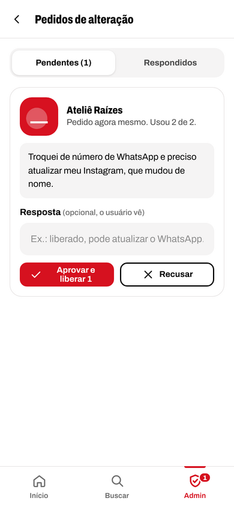

# Esquerda Indica

Rede de contatos profissionais do nosso grupo. Quem trabalha com alguma coisa cria um perfil, e quem precisa de um serviço encontra alguém de confiança por tipo de serviço, estado e cidade.

O app funciona no navegador, mas foi pensado para o celular: dá para instalar na tela inicial como um aplicativo comum.

<p>
  
  
  
</p>

## Por que existe

O grupo sempre funcionou como um mural de indicações: alguém pergunta "conhecem um eletricista em Juiz de Fora?" e os contatos aparecem no meio da conversa. Funciona, mas a informação se perde em poucos dias e ninguém consegue procurar o que já foi indicado.

O Esquerda Indica organiza isso. Cada pessoa cadastra o próprio trabalho uma vez, mantém os dados atualizados e qualquer membro encontra o contato em segundos.

## O que já funciona

**Cadastro e conta**
- Perfil com nome do responsável, empresa ou nome completo, telefone, WhatsApp, Instagram, descrição, foto ou logo, estado e cidade.
- 186 tipos de serviço organizados em 16 grupos, com a opção "Outro" para quem não se encaixa na lista.
- Todos os 5.570 municípios do IBGE disponíveis no cadastro.
- Área de atendimento: só a cidade, a cidade e vizinhas, o estado inteiro ou o Brasil todo, além de atendimento online.
- Aceite da política de privacidade (LGPD) registrado com data.
- Login por e-mail e senha, recuperação por e-mail e troca de senha.
- Cada pessoa pode editar o perfil duas vezes. Depois disso, pede uma nova alteração à administração explicando o motivo. Salvar sem mudar nada não conta.
- Exclusão da conta pela própria pessoa, com confirmação por senha.

**Busca (só para membros cadastrados)**
- Filtros por tipo de serviço, estado e cidade. Só aparecem opções que têm alguém cadastrado, com a quantidade ao lado.
- Busca por nome, serviço ou palavra da descrição.
- Considera a área de atendimento: quem atende a região aparece numa seção separada, depois de quem é da cidade.
- Perfil com atalhos para WhatsApp (com mensagem pronta), ligação, Instagram, compartilhar e salvar na agenda do celular.

**Tela inicial**
- Contadores de profissionais ativos e de cadastros no total.
- Destaque para quem acabou de entrar, serviços mais presentes na rede e profissionais da sua cidade.

**Administração**
- Painel com os números da rede.
- Gestão de usuários: editar dados (sem gastar as alterações da pessoa), ajustar ou zerar o limite de alterações, bloquear com motivo, desbloquear, definir nova senha e excluir.
- Fila de pedidos de alteração, com aprovação ou recusa e resposta que a pessoa vê na conta dela.
- Histórico de tudo o que acontece: cada edição mostra o antes e o depois. Contas excluídas continuam no histórico com os dados, a foto e os pedidos feitos.
- Gestão dos tipos de serviço, incluindo transformar um "Outro" que se repete em tipo oficial e mover os perfis automaticamente.

<p>
  
  
  
</p>

## Tecnologias

- PHP 8.1 ou mais novo, sem framework e sem Composer.
- MySQL 8 ou MariaDB 10.6+.
- HTML, CSS e JavaScript puros. Nenhuma biblioteca de interface: seletores, diálogos, avisos e ícones são próprios do projeto.
- Fonte Archivo hospedada junto com o app (licença OFL), sem chamadas ao Google Fonts.
- PWA com service worker: o app pode ser instalado no celular e mostra uma tela própria quando está sem internet. Páginas com dados pessoais nunca ficam em cache.

## Rodando no seu computador

Você vai precisar de PHP 8.1+ (com as extensões `pdo_mysql`, `gd` e `mbstring`) e de um MySQL ou MariaDB.

```bash
# 1. Banco de dados
mysql -u root -e "CREATE DATABASE esquerda_indica CHARACTER SET utf8mb4 COLLATE utf8mb4_unicode_ci;"

# 2. Configuração: copie o exemplo, ajuste o acesso ao banco e deixe 'debug' => true
cp app/config.example.php app/config.php

# 3. Tabelas, cidades, serviços e o usuário administrador (pede a senha)
php bin/instalar.php voce@email.com "Seu nome"

# 4. Opcional: perfis fictícios para ver as telas preenchidas (senha de todos: senha1234)
php bin/dados-exemplo.php

# 5. Servidor de desenvolvimento
php -S localhost:8080 -t public public/index.php
```

Depois é só abrir `http://localhost:8080`.

## Publicando

O caminho mais curto num servidor Ubuntu é clonar o repositório e rodar o script de publicação. Ele instala o que faltar, cria o banco, configura o Nginx (ou o Apache, se for ele que já estiver rodando) e ativa o HTTPS:

```bash
git clone https://github.com/USUARIO/esquerda-indica.git /root/esquerda-indica
bash /root/esquerda-indica/bin/publicar.sh seudominio.com.br seu-email@dominio.com
```

Para atualizar, `git pull` e o mesmo comando de novo. Banco, configuração e fotos são mantidos.

O passo a passo manual, a configuração do Nginx e do Apache e os ajustes mais comuns estão em [docs/instalacao.md](docs/instalacao.md).

## Organização do código

```
app/
  pages/       uma página por rota (lógica e validação)
  views/       telas em PHP com HTML
  lib/         banco, autenticação, perfil, fotos, e-mail e funções gerais
  config.example.php
bin/
  instalar.php       cria tabelas, importa dados e o administrador
  publicar.sh        publicação e atualização no servidor
  dados-exemplo.php  perfis fictícios para desenvolvimento
database/      SQL das tabelas, estados, cidades e tipos de serviço
docs/          instalação e capturas de tela
public/        única pasta exposta na web
storage/       arquivos privados (fotos de contas excluídas)
```

Todas as rotas passam por `public/index.php`. Cada rota aponta para um arquivo em `app/pages/`, que valida, grava e chama uma tela de `app/views/`.

## Segurança e privacidade

- Senhas com `password_hash` e tokens de recuperação guardados só como hash, válidos por 1 hora.
- Proteção contra CSRF em todos os formulários e limite de tentativas de login por IP e por e-mail.
- Consultas ao banco sempre com parâmetros (prepared statements).
- Fotos reprocessadas no servidor (recorte, redimensionamento e conversão para WebP), o que descarta metadados e qualquer conteúdo escondido no arquivo.
- A pasta de fotos não executa scripts.
- Contatos só aparecem para quem está logado. As páginas não são indexadas por buscadores.

## Histórico e próximos passos

- [CHANGELOG.md](CHANGELOG.md): tudo o que mudou, em ordem cronológica.
- [ROADMAP.md](ROADMAP.md): o que está planejado para as próximas versões.

## Licença

Projeto de uso do grupo Esquerda Indica. Para reutilizar o código em outro projeto, fale com o mantenedor.

A fonte Archivo é distribuída sob a SIL Open Font License, incluída em `public/assets/fontes/`.
