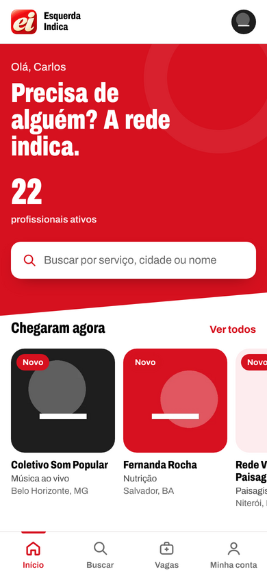
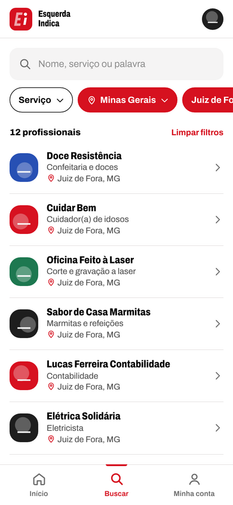
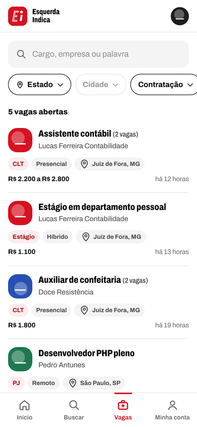
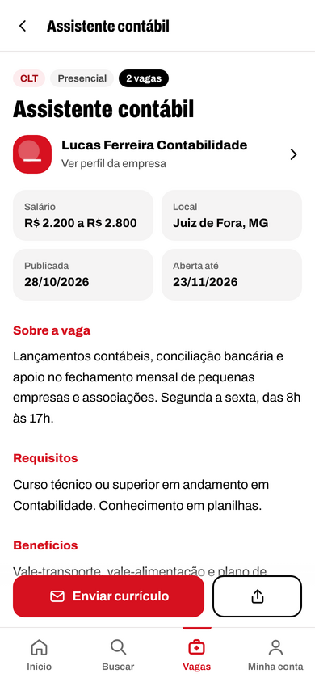
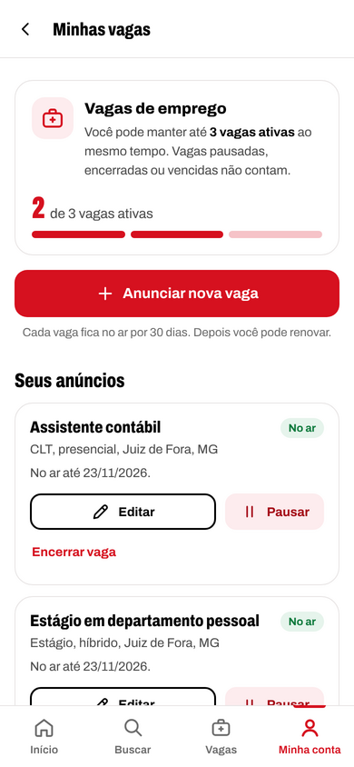
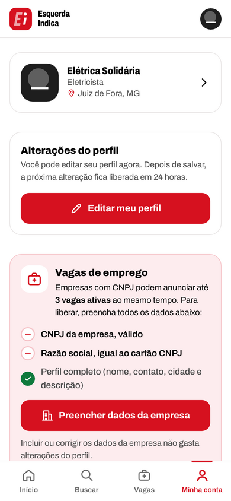
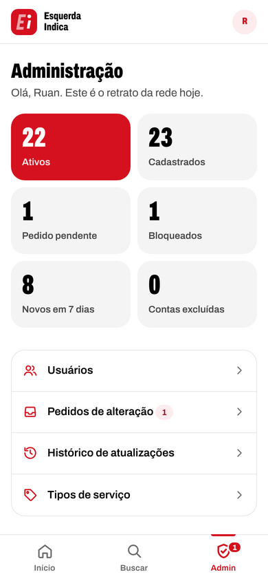
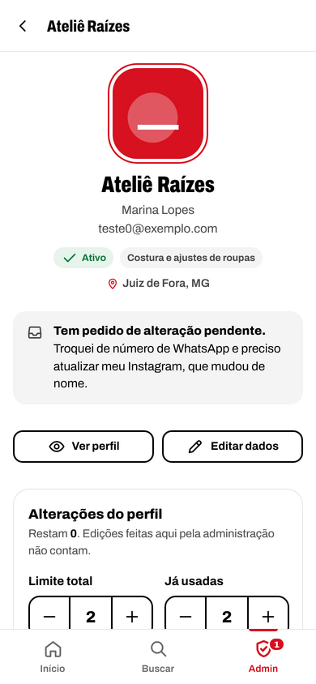
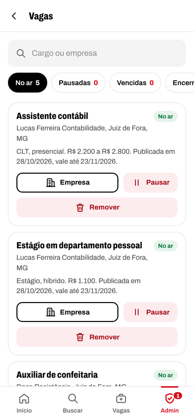
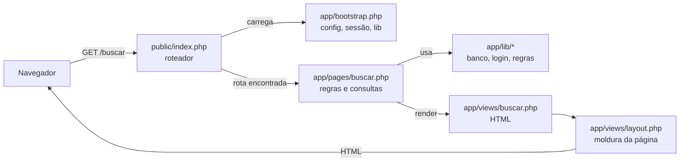

<div align="center">


**A rede de contatos profissionais do grupo, organizada num app.**<br>
Quem trabalha cria um perfil. Quem precisa encontra alguém de confiança por serviço, estado e cidade.

[](https://github.com/esquerdaindica-gif/esquerda-indica/actions/workflows/verificacao.yml)


[Site](https://esquerdaindica.com) ·
[Rodar no computador](#rodando-no-seu-computador) ·
[Publicar](#publicando) ·
[Arquitetura](docs/arquitetura.md) ·
[Contribuir](CONTRIBUTING.md)

</div>

<p align="center">
  
  
  
</p>

## Sumário

- [Por que existe](#por-que-existe)
- [O que já funciona](#o-que-já-funciona)
- [Tecnologias e decisões de projeto](#tecnologias-e-decisões-de-projeto)
- [Rodando no seu computador](#rodando-no-seu-computador)
- [Como o código funciona](#como-o-código-funciona)
- [Publicando](#publicando)
- [Planos e limites de vagas](#planos-e-limites-de-vagas)
- [Organização das pastas](#organização-das-pastas)
- [Segurança e privacidade](#segurança-e-privacidade)
- [Documentação](#documentação)
- [Contribuindo](#contribuindo)
- [Licença](#licença)

## Por que existe

O grupo sempre funcionou como um mural de indicações: alguém pergunta "conhecem um eletricista em Juiz de Fora?" e os contatos aparecem no meio da conversa. Funciona, mas a informação se perde em poucos dias e ninguém consegue procurar o que já foi indicado.

O Esquerda Indica organiza isso. Cada pessoa cadastra o próprio trabalho uma vez, mantém os dados atualizados e qualquer membro encontra o contato em segundos.

O app funciona no navegador, mas foi pensado para o celular: dá para instalar na tela inicial como um aplicativo comum.

## O que já funciona

**Cadastro e conta**
- Perfil com nome do responsável, empresa ou nome completo, telefone, WhatsApp, Instagram, descrição, foto ou logo, estado e cidade.
- 186 tipos de serviço organizados em 16 grupos, com a opção "Outro" para quem não se encaixa na lista.
- Todos os 5.570 municípios do IBGE disponíveis no cadastro.
- Área de atendimento: só a cidade, a cidade e vizinhas, o estado inteiro ou o Brasil todo, além de atendimento online.
- Aceite da política de privacidade (LGPD) registrado com data.
- Login por e-mail e senha, recuperação por e-mail e troca de senha.
- Edição do perfil uma vez a cada 24 horas. Quem precisa mudar antes pode pedir liberação à administração. A administração também pode trocar para a regra de quantidade fixa de alterações. Salvar sem mudar nada não conta.
- CNPJ e razão social opcionais, numa área própria que não gasta alterações. O CNPJ é conferido e aceita o novo formato com letras.
- Exclusão da conta pela própria pessoa, com confirmação por senha.

**Busca (só para membros cadastrados)**
- Filtros por tipo de serviço, estado e cidade. Só aparecem opções que têm alguém cadastrado, com a quantidade ao lado.
- Busca por nome, serviço ou palavra da descrição.
- Considera a área de atendimento: quem atende a região aparece numa seção separada, depois de quem é da cidade.
- Perfil com atalhos para WhatsApp (com mensagem pronta), ligação, Instagram, compartilhar e salvar na agenda do celular.

**Vagas de emprego**
- Empresas com CNPJ e razão social anunciam até 3 vagas ativas ao mesmo tempo. O app mostra com clareza o que falta preencher e quanto do limite está em uso.
- Cada vaga tem cargo, contratação, modalidade, local, salário, descrição, requisitos, benefícios e forma de candidatura (WhatsApp, e-mail ou link).
- A candidatura é direto com a empresa. O app não recebe nem guarda currículos.
- Vagas ficam no ar por 30 dias e podem ser pausadas, renovadas e encerradas.
- Aba Vagas com busca por texto, estado, cidade, contratação e modalidade.

<p align="center">
  
  
  
</p>

**Tela inicial**
- Contador de profissionais ativos na rede.
- Destaque para quem acabou de entrar, vagas abertas, serviços mais presentes na rede e profissionais da sua cidade.

**Administração**
- Painel com os números da rede.
- Gestão de usuários: editar dados (sem gastar as alterações da pessoa), ajustar ou zerar o limite de alterações, bloquear com motivo, desbloquear, definir nova senha e excluir.
- Fila de pedidos de alteração, com aprovação ou recusa e resposta que a pessoa vê na conta dela.
- Histórico de tudo o que acontece: cada edição mostra o antes e o depois. Contas excluídas continuam no histórico com os dados, a foto e os pedidos feitos.
- Gestão dos tipos de serviço, incluindo transformar um "Outro" que se repete em tipo oficial e mover os perfis automaticamente.
- Vagas: liberar, bloquear ou mudar o limite de cada empresa, pausar ou remover anúncios com motivo.
- Planos com preço e limite de vagas, atribuídos manualmente enquanto a cobrança não está ligada.
- Configurações gerais: regra de edição do perfil, vagas ligadas ou desligadas, limite padrão e validade das vagas.

<p align="center">
  
  
  
</p>

Todas as telas estão em [docs/telas](docs/telas).

## Tecnologias e decisões de projeto

| Camada | Escolha | Por quê |
|---|---|---|
| Servidor | PHP 8.1+ puro, sem framework e sem Composer | Roda em qualquer hospedagem, não tem dependência para atualizar e o código é lido de cima a baixo sem "mágica". |
| Banco | MySQL 8 ou MariaDB 10.6+ | Disponível em todo servidor. Todas as consultas usam parâmetros. |
| Interface | HTML, CSS e JavaScript puros | Seletores, diálogos, avisos e ícones são do próprio projeto. Nada de biblioteca de interface. |
| Fonte | Archivo, hospedada junto com o app (licença OFL) | Sem chamadas ao Google Fonts, o que ajuda a privacidade e a velocidade. |
| Celular | PWA com service worker | Instala na tela inicial e mostra uma tela própria sem internet. Páginas com dados pessoais nunca ficam em cache. |

O resultado é um app que cabe numa hospedagem simples, abre rápido no celular e pode ser entendido por quem sabe o básico de PHP.

## Rodando no seu computador

Você vai precisar de PHP 8.1+ (com as extensões `pdo_mysql`, `gd` e `mbstring`) e de um MySQL ou MariaDB.

```bash
# 1. Baixe o código
git clone https://github.com/esquerdaindica-gif/esquerda-indica.git esquerda-indica
cd esquerda-indica

# 2. Crie o banco de dados
mysql -u root -e "CREATE DATABASE esquerda_indica CHARACTER SET utf8mb4 COLLATE utf8mb4_unicode_ci;"

# 3. Configuração: copie o exemplo, ajuste o acesso ao banco e deixe 'debug' => true
cp app/config.example.php app/config.php

# 4. Tabelas, cidades, serviços e o usuário administrador (pede a senha)
php bin/instalar.php voce@email.com "Seu nome"

# 5. Opcional: perfis fictícios para ver as telas preenchidas (senha de todos: senha1234)
php bin/dados-exemplo.php

# 6. Servidor de desenvolvimento
php -S localhost:8080 -t public public/index.php
```

Depois é só abrir `http://localhost:8080` e entrar com o e-mail do passo 4.

## Como o código funciona

Toda requisição entra por um único arquivo, `public/index.php`, que descobre qual página chamar. A página faz o trabalho (valida, consulta, grava) e entrega o resultado para uma tela.



O guia de [arquitetura](docs/arquitetura.md) explica cada etapa com exemplos: o ciclo de uma requisição, o padrão dos formulários, o modelo do banco, as migrações e receitas para criar uma página nova ou mudar uma tabela.

## Publicando

O caminho mais curto num servidor Ubuntu (24.04 ou mais novo) é clonar o repositório e rodar o script de publicação. Ele instala o que faltar, cria o banco, configura o Nginx (ou o Apache, se for ele que já estiver rodando) e ativa o HTTPS:

```bash
git clone https://github.com/esquerdaindica-gif/esquerda-indica.git /root/esquerda-indica
bash /root/esquerda-indica/bin/publicar.sh seudominio.com.br seu-email@dominio.com
```

Para atualizar, `git pull` e o mesmo comando de novo. Banco, configuração e fotos são mantidos, e as mudanças de banco pendentes são aplicadas sozinhas.

O passo a passo manual, a configuração do Nginx e do Apache e os ajustes mais comuns estão em [docs/instalacao.md](docs/instalacao.md).

## Planos e limites de vagas

O limite de vagas de cada empresa é decidido em um só lugar (`direito_vagas()` em `app/lib/regras.php`), nesta ordem:

1. limite próprio definido pela administração na ficha da conta;
2. plano ativo da conta (tabela `assinaturas`);
3. limite padrão do site, nas configurações.

As tabelas `planos`, `assinaturas` e `pagamentos` já existem. Para começar a cobrar, falta integrar um meio de pagamento que crie a assinatura quando o pagamento for confirmado. O resto do app já respeita o plano.

## Organização das pastas

```
app/
  bootstrap.php       carrega a configuração, a sessão e as bibliotecas
  config.example.php  modelo do app/config.php (que nunca vai para o Git)
  lib/                banco, autenticação, perfil, regras (edição, CNPJ, vagas, planos),
                      fotos, e-mail, migrações e funções gerais
  pages/              uma página por rota: valida, consulta e grava
  views/              telas em PHP com HTML, mais o layout comum
bin/
  instalar.php        cria tabelas, importa dados e o administrador
  migrar.php          aplica mudanças de banco pendentes
  publicar.sh         publicação e atualização no servidor
  dados-exemplo.php   perfis fictícios para desenvolvimento
database/
  01_estrutura.sql    tabelas da primeira versão
  02_estados_cidades.sql, 03_servicos.sql   dados iniciais
  migracoes/          mudanças de banco de cada versão, aplicadas em ordem
docs/                 instalação, arquitetura e capturas de tela
public/               única pasta exposta na web (index.php, CSS, JS, ícones, service worker)
storage/              arquivos privados (fotos de contas excluídas)
```

## Segurança e privacidade

- Senhas com `password_hash` e tokens de recuperação guardados só como hash, válidos por 1 hora.
- Proteção contra CSRF em todos os formulários e limite de tentativas de login por IP e por e-mail.
- Consultas ao banco sempre com parâmetros (prepared statements).
- Fotos reprocessadas no servidor (recorte, redimensionamento e conversão para WebP), o que descarta metadados e qualquer conteúdo escondido no arquivo.
- A pasta de fotos não executa scripts, e só a pasta `public` fica exposta na web.
- Contatos só aparecem para quem está logado. As páginas não são indexadas por buscadores.

Encontrou uma falha? Veja como avisar com segurança em [SECURITY.md](SECURITY.md).

## Documentação

| Documento | Para quê |
|---|---|
| [docs/instalacao.md](docs/instalacao.md) | Publicar num servidor, com o script ou passo a passo |
| [docs/arquitetura.md](docs/arquitetura.md) | Entender o código e fazer mudanças com segurança |
| [CONTRIBUTING.md](CONTRIBUTING.md) | Convenções do projeto e como propor mudanças |
| [CHANGELOG.md](CHANGELOG.md) | Tudo o que mudou, versão a versão |
| [ROADMAP.md](ROADMAP.md) | O que está planejado para as próximas versões |
| [SECURITY.md](SECURITY.md) | Como relatar uma vulnerabilidade |

## Contribuindo

Sugestões e correções são bem-vindas. Abra uma [issue](https://github.com/esquerdaindica-gif/esquerda-indica/issues/new/choose) para relatar um problema ou propor uma ideia, e leia o [CONTRIBUTING.md](CONTRIBUTING.md) antes de enviar um pull request.

## Licença

Projeto de uso do grupo Esquerda Indica. Para reutilizar o código em outro projeto, fale com o mantenedor.

A fonte Archivo é distribuída sob a SIL Open Font License, incluída em `public/assets/fontes/`.
