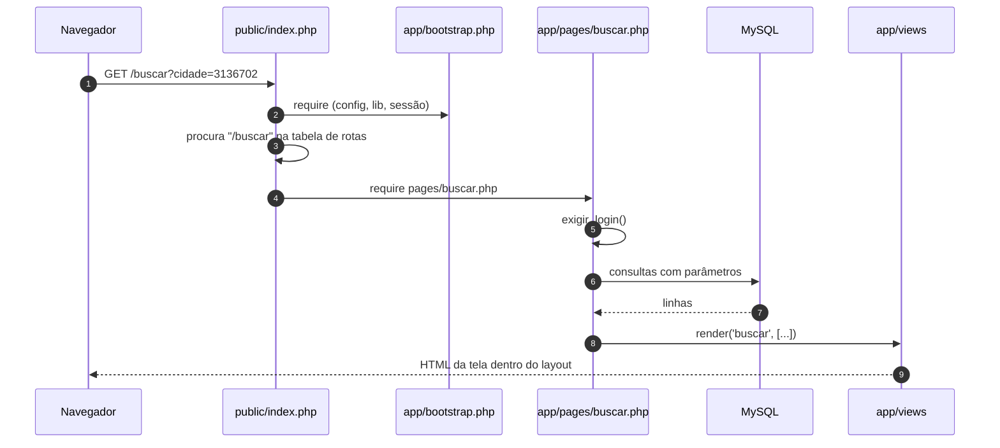
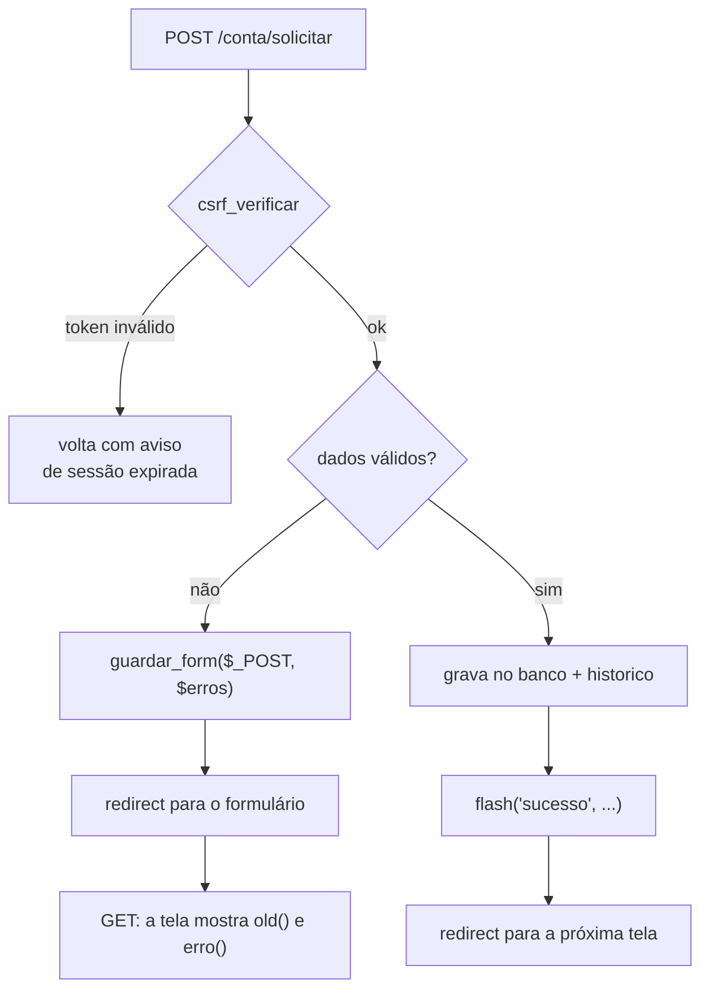
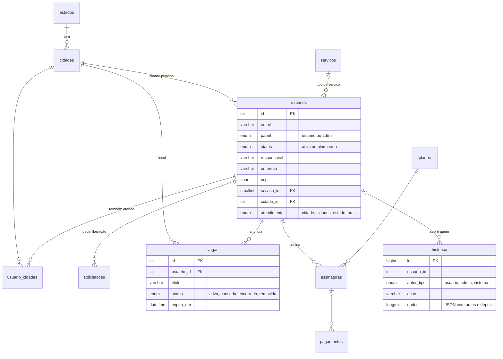

# Arquitetura

Este guia explica como o Esquerda Indica funciona por dentro. A ideia é que alguém que saiba o básico de PHP consiga ler o código, entender por onde cada informação passa e fazer mudanças sem quebrar nada.

## Sumário

1. [Visão geral](#1-visão-geral)
2. [O caminho de uma requisição](#2-o-caminho-de-uma-requisição)
3. [Páginas e telas](#3-páginas-e-telas)
4. [Formulários: validar, guardar e redirecionar](#4-formulários-validar-guardar-e-redirecionar)
5. [Login, sessão e permissões](#5-login-sessão-e-permissões)
6. [Banco de dados](#6-banco-de-dados)
7. [Regras de negócio](#7-regras-de-negócio)
8. [Histórico e auditoria](#8-histórico-e-auditoria)
9. [App no celular (PWA)](#9-app-no-celular-pwa)
10. [Receitas](#10-receitas)
11. [Referência rápida de funções](#11-referência-rápida-de-funções)

## 1. Visão geral

O app é PHP puro, sem framework. Em vez de esconder o funcionamento atrás de classes e convenções, cada parte é um arquivo pequeno que faz uma coisa:

| Pasta | Papel | Analogia |
|---|---|---|
| `public/index.php` | Recebe todas as requisições e escolhe a página | A recepção |
| `app/bootstrap.php` | Carrega configuração, bibliotecas e sessão | Acender as luzes antes de abrir |
| `app/pages/` | Uma página por rota: valida, consulta e grava | O atendimento |
| `app/views/` | HTML de cada tela, mais o `layout.php` comum | A vitrine |
| `app/lib/` | Funções usadas por várias páginas | A caixa de ferramentas |
| `database/` | Estrutura do banco, dados iniciais e migrações | A planta da casa |
| `bin/` | Comandos de terminal: instalar, migrar, publicar | O manual de obra |

Só a pasta `public/` fica exposta na web. O resto (código, configuração, fotos de contas excluídas) não pode ser aberto pelo navegador.

## 2. O caminho de uma requisição

Exemplo: uma pessoa logada abre `/buscar?cidade=3136702`.



O que acontece em cada passo:

1. **Servidor web.** O Nginx (ou o Apache) entrega arquivos que existem em `public/`, como CSS e imagens. Todo o resto vai para `public/index.php`.
2. **Bootstrap.** `app/bootstrap.php` lê `app/config.php`, define o fuso horário, carrega as bibliotecas de `app/lib/`, abre a sessão com cookie seguro e envia cabeçalhos de proteção (`X-Frame-Options`, `nosniff`, `Referrer-Policy`).
3. **Rota.** `public/index.php` tem um array `$rotas`. Rotas fixas são comparadas direto (`'/buscar' => 'buscar'`). Rotas com número usam expressão regular (`'#^/p/(\d+)$#' => 'perfil'`), e o número vira a variável `$param`.
4. **Proteções comuns.** Antes de chamar a página, todo `POST` passa por `csrf_verificar()`, e os dados de um formulário que voltou com erro são recarregados com `carregar_form_sessao()`.
5. **Página.** O arquivo de `app/pages/` faz o trabalho e termina chamando `render()`, `redirect()` ou `json_out()`. As três encerram a requisição.
6. **Erro inesperado.** Qualquer exceção é registrada no log do PHP. Com `'debug' => true` aparece na tela. Sem debug, a pessoa vê uma página amigável de erro.

## 3. Páginas e telas

A página decide **o que** mostrar. A tela decide **como** mostrar. Essa separação deixa as telas sem consultas ao banco e as páginas sem HTML.

```php
// app/pages/conta_solicitar.php (resumido)
$eu = exigir_login();

$pedidos = all('SELECT * FROM solicitacoes WHERE usuario_id = ? ORDER BY id DESC LIMIT 20', [$eu['id']]);

render('conta_solicitar', [
    'titulo'  => 'Solicitar alteração',   // título no topo e na aba do navegador
    'voltar'  => url('conta'),            // mostra a seta de voltar
    'aba'     => 'conta',                 // destaca a aba certa no menu de baixo
    'pedidos' => $pedidos,
]);
```

`render()` transforma cada chave do array em variável, gera o HTML de `app/views/conta_solicitar.php` e coloca o resultado dentro de `app/views/layout.php`. O layout cuida do topo, do menu de abas, das mensagens (`flash`) e do `<head>`.

Pedaços que se repetem em várias telas, como o cartão de um profissional, ficam em views próprias e são incluídos com `partial('item_profissional', [...])`.

Duas regras valem para toda tela:

- **Todo texto que vem do banco ou do usuário passa por `e()`**, que escapa o HTML. É o que impede que alguém injete código na página.
- **Links e arquivos usam `url()` e `asset()`**, para o app funcionar tanto na raiz do domínio quanto numa subpasta (`base_path` na configuração).

## 4. Formulários: validar, guardar e redirecionar

Todo formulário segue o padrão **Post, Redirect, Get**: o `POST` nunca devolve HTML direto. Ele grava e redireciona, ou guarda os erros e redireciona de volta. Assim, recarregar a página nunca envia o formulário duas vezes.



No código:

```php
if (is_post()) {
    $motivo = trim((string)($_POST['motivo'] ?? ''));
    if (mb_strlen($motivo) < 15) {
        guardar_form($_POST, ['motivo' => 'Explique em pelo menos 15 caracteres.']);
        redirect('conta/solicitar');
    }
    q('INSERT INTO solicitacoes (usuario_id, motivo) VALUES (?, ?)', [$eu['id'], $motivo]);
    historico((int)$eu['id'], label_usuario($eu), 'solicitacao', 'Pediu liberação para alterar o perfil');
    flash('sucesso', 'Pedido enviado. A administração vai analisar.');
    redirect('conta');
}
```

E na tela:

```php
<form method="post" action="<?= e(url('conta/solicitar')) ?>">
  <?= csrf_field() ?>
  <div class="campo<?= tem_erro('motivo') ?>">
    <textarea name="motivo"><?= e(old('motivo')) ?></textarea>
    <?= erro('motivo') ?>
  </div>
</form>
```

| Função | O que faz |
|---|---|
| `csrf_field()` | Campo escondido com o token da sessão. Obrigatório em todo `<form method="post">`. |
| `guardar_form($dados, $erros)` | Guarda o que foi digitado (menos senhas) e os erros na sessão, para a próxima tela. |
| `old('campo')` | Devolve o que a pessoa tinha digitado. |
| `erro('campo')` / `tem_erro('campo')` | Mostra a mensagem de erro e marca o campo em vermelho. |
| `flash('sucesso' \| 'erro', 'texto')` | Aviso que aparece uma única vez na próxima tela. |

Requisições feitas pelo JavaScript mandam o token no cabeçalho `X-CSRF-Token`, que `csrf_verificar()` também aceita.

## 5. Login, sessão e permissões

- A sessão guarda só o id da pessoa (`$_SESSION['uid']`). A cada requisição, `usuario_atual()` busca a conta no banco. Se ela foi bloqueada ou excluída, a sessão cai na hora.
- `exigir_login()` no início de uma página manda para `/entrar` quem não está logado e lembra para onde a pessoa queria ir.
- `exigir_admin()` responde **404** para quem não é administrador, em vez de 403, para não revelar que a página existe.
- No login e na troca de senha o id da sessão é trocado (`session_regenerate_id`), o que evita roubo de sessão.
- `login_bloqueado()` limita a 6 erros em 15 minutos, por IP e por e-mail (tabela `tentativas_login`).
- O cookie é `HttpOnly`, `SameSite=Lax` e `Secure` quando o site está em HTTPS, e dura 30 dias.

## 6. Banco de dados

### Acesso

Toda consulta passa por quatro funções de `app/lib/db.php`, sempre com `?` no lugar dos valores:

```php
$u      = one('SELECT * FROM usuarios WHERE id = ?', [$id]);          // uma linha ou null
$lista  = all('SELECT * FROM vagas WHERE status = ?', ['ativa']);     // várias linhas
$total  = val('SELECT COUNT(*) FROM usuarios');                       // um valor só
q('UPDATE usuarios SET status = ? WHERE id = ?', ['bloqueado', $id]); // executa
```

Quando várias gravações precisam acontecer juntas, use `transacao(function () { ... })`. Se algo falhar no meio, nada é gravado.

### Modelo

As tabelas principais e como se ligam:



Tabelas de apoio que não aparecem no diagrama: `senha_tokens` (recuperação de senha, guardada só como hash), `tentativas_login`, `configuracoes` (chave e valor do painel) e `migracoes` (controle das mudanças já aplicadas).

### Migrações

O banco muda junto com o código, e cada mudança fica num arquivo numerado em `database/migracoes/`:

```
database/migracoes/
  0001_vagas_empresas_planos.sql
  0002_...                       ← a próxima mudança
```

`php bin/migrar.php` aplica, em ordem, só os arquivos que ainda não rodaram naquele banco, e anota cada um na tabela `migracoes`. Pode ser rodado quantas vezes for preciso. O `publicar.sh` chama esse comando sozinho em toda atualização, e o `instalar.php` aplica todas numa instalação nova.

> Nunca altere uma migração que já foi publicada. Se algo precisa mudar, crie uma nova. É assim que todas as instalações chegam ao mesmo banco.

## 7. Regras de negócio

Tudo o que decide "pode ou não pode" mora em `app/lib/regras.php`. Assim, a tela, a página e o painel sempre concordam:

| Função | Responde |
|---|---|
| `situacao_edicao($u)` | A pessoa pode editar o perfil agora? Se não, quando pode? |
| `cnpj_valido($cnpj)` | O CNPJ confere, incluindo o novo formato com letras? |
| `direito_vagas($u)` | Quantas vagas a empresa pode ter ativas, e por quê? |
| `situacao_vaga($v)` | A vaga está no ar, pausada, vencida ou removida? |
| `cfg('chave')` | Qual o valor atual de uma configuração do painel? |

As configurações têm um valor padrão em `CONFIG_PADRAO` e podem ser trocadas pela administração, que grava na tabela `configuracoes`. Se a tabela ainda não existe (antes da migração), o app usa os padrões e continua funcionando.

## 8. Histórico e auditoria

Toda ação importante chama `historico()`:

```php
// app/pages/conta_editar.php
historico((int)$p['id'], label_usuario($p), 'edicao', $resumo, ['mudancas' => $mudancas], 'usuario');
```

A função registra quem fez (pessoa, administrador ou sistema), sobre quem, o que foi feito (`acao`), um resumo, os dados em JSON e o IP. Na edição de perfil, `$mudancas` traz cada campo com o valor antigo e o novo, e é daqui que o painel mostra o "antes e depois".

`usuario_label` guarda o nome da pessoa no momento da ação. Por isso o histórico continua legível mesmo depois que uma conta é excluída.

## 9. App no celular (PWA)

- `public/manifest.webmanifest` define nome, cores e ícones do app instalado.
- `public/sw.js` é o service worker, com duas estratégias:
  - **Páginas:** sempre da rede. Dados pessoais nunca ficam guardados no aparelho. Sem internet, aparece a tela `/offline`.
  - **Arquivos visuais** (`/assets/`): primeiro do cache, atualizando em segundo plano. O app abre rápido mesmo com internet lenta.
- Ao mudar CSS, JS ou ícones de forma que precise chegar a quem já instalou, aumente a constante `VERSAO` em `sw.js` (por exemplo de `ei-v3` para `ei-v4`). O cache antigo é apagado na próxima abertura.

## 10. Receitas

### Criar uma página nova

Exemplo: uma página `/ajuda` aberta a todos.

1. Registre a rota em `public/index.php`:
   ```php
   '/ajuda' => 'ajuda',
   ```
2. Crie `app/pages/ajuda.php`:
   ```php
   <?php
   render('ajuda', ['titulo' => 'Ajuda', 'voltar' => url('/')]);
   ```
3. Crie `app/views/ajuda.php` com o HTML, usando as classes que já existem em `public/assets/css/app.css` (`secao`, `secao-titulo`, `aviso`...).
4. Se a página for só para membros, comece com `$eu = exigir_login();`. Se for da administração, use `exigir_admin()` e coloque os arquivos em `pages/admin/` e `views/admin/`.

### Mudar o banco

Exemplo: guardar o site de cada profissional.

1. Crie `database/migracoes/0002_site_do_profissional.sql`:
   ```sql
   -- Endereço do site do profissional, opcional
   ALTER TABLE usuarios ADD COLUMN site VARCHAR(200) NULL AFTER instagram;
   ```
2. Rode `php bin/migrar.php` no seu computador.
3. Ajuste a validação em `validar_perfil()` (`app/lib/perfil.php`), o formulário em `app/views/form_perfil.php` e a exibição em `app/views/perfil.php`.
4. Se o campo deve aparecer no "antes e depois" do histórico, inclua em `perfil_snapshot()`.
5. Registre a mudança no `CHANGELOG.md`.

### Criar uma configuração no painel

1. Adicione a chave e o valor padrão em `CONFIG_PADRAO` (`app/lib/regras.php`).
2. Leia com `cfg('sua_chave')` onde a regra for usada.
3. Inclua o campo em `app/pages/admin/configuracoes.php` e `app/views/admin/configuracoes.php`.

### Enviar um e-mail

```php
$html = email_modelo('Seu pedido foi aprovado', 'Você já pode editar o seu perfil.', 'Abrir o app', url_absoluta('conta'));
enviar_email($u['email'], 'Pedido aprovado', $html);
```

Com o bloco `mail` preenchido em `app/config.php`, o envio é por SMTP. Sem ele, o app usa a função `mail()` do servidor.

## 11. Referência rápida de funções

| Arquivo | Funções principais |
|---|---|
| `lib/db.php` | `db`, `q`, `one`, `all`, `val`, `transacao` |
| `lib/helpers.php` | `e`, `url`, `asset`, `redirect`, `voltar`, `is_post`, `input`, `csrf_*`, `flash`, `guardar_form`, `old`, `erro`, `render`, `partial`, `json_out`, `nao_encontrado`, `icon`, `historico`, formatação de telefone, datas e plurais |
| `lib/auth.php` | `usuario_atual`, `eh_admin`, `exigir_login`, `exigir_admin`, `fazer_login`, `fazer_logout`, limite de tentativas |
| `lib/perfil.php` | `carregar_perfil`, `validar_perfil`, `salvar_perfil`, `perfil_snapshot`, `diff_snapshot`, `excluir_usuario` |
| `lib/regras.php` | `cfg`, `situacao_edicao`, `cnpj_valido`, `validar_empresa`, `direito_vagas`, `validar_vaga`, `situacao_vaga` |
| `lib/foto.php` | `processar_foto` (recorta, reduz e converte para WebP), `apagar_foto` |
| `lib/mail.php` | `enviar_email`, `email_modelo` |
| `lib/migracoes.php` | `aplicar_migracoes`, `comandos_sql` |
